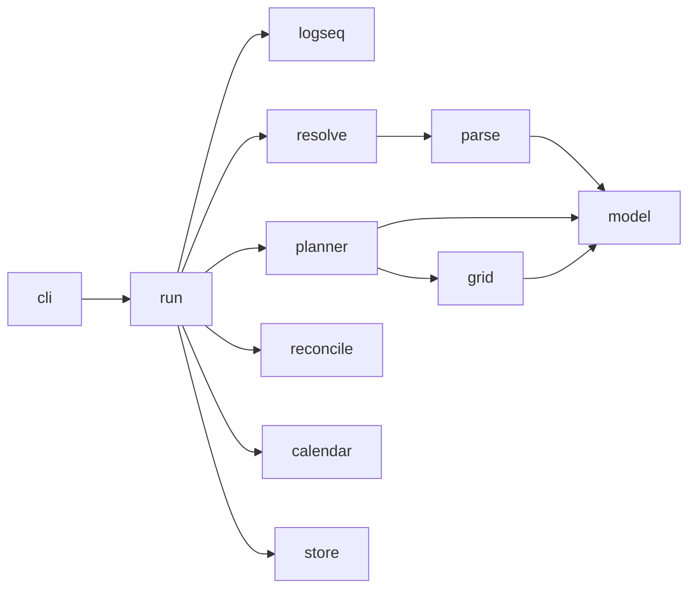

# Lodo — agent/developer map

Local-first CLI that reads schedulable Tasks from a Logseq graph, computes a Schedule, and
projects it to **one** Google Calendar. Logseq is the only interface for intent. The CLI
renders commands and output; `internal/planner` decides placements.

## Core pipeline



1. **Read** Logseq graph payloads (`internal/logseq`) — HTTP only, read-only (ADR 0002).
   `internal/run` walks pages and block trees. One Logseq graph is a `run.Source`;
   several sources are read the same way.
2. **Resolve** (`internal/resolve`) turns those payloads into Tasks, Time Maps,
   dependencies, provenance, and validation issues. Resolution is deterministic and
   reports an issue when data is unparseable or ambiguous. Parsing lives in
   `internal/parse` and `internal/norm`.
3. **Plan** (`internal/planner`) is a pure function of resolved Tasks, Time Maps, a busy
   mask, dispositions, and scheduling config (ADR 0006). `internal/grid` is the slot
   grid it places onto (ADR 0008). `run.Forecast` is that plan with no store: the dry
   run behind `forecast` and `schedule --dry-run`.
4. **Reconcile and project** (`internal/reconcile`, `internal/calendar`, `internal/store`).
   `schedule` and `check` fold calendar edits into dispositions before planning.
   `internal/store` (SQLite) is the system of record for bindings, snapshots, and
   dispositions (ADR 0001). The calendar is a projection. Writes go to the calendar
   before the store commit (ADR 0007). `internal/gauth` is the Google OAuth loopback
   `internal/calendar` authenticates with.

`refresh` is the pull-only path: it reconciles calendar edits into the store and does
not resolve the graph or recompute the Schedule.

## Key packages

- `cmd/lodo/main.go`: process entrypoint; calls `cli.Run`.
- `internal/cli`: Cobra command tree, flags, config loading, command handlers, and
  human/JSON output. Keep wiring explicit. Read-only commands stay off the calendar
  and the store commit. New commands render through `views.go`.
- `internal/run`: the command loop. `Forecast` reads, resolves, and plans. `Schedule`
  and `Check` reconcile, then plan. `Refresh` folds calendar edits without recomputing.
  Forecast, check, and schedule share `Scheduled` (tasks, issues, schedule, busy);
  each outcome keeps only the fields that command adds.
- `internal/resolve`: graph payloads to Tasks, Time Maps, issues, and provenance.
- `internal/planner`: `Plan` produces a Schedule. The package comment names which file
  owns which stage. `search.go` emits Blocks; `comparator.go` is the ADR 0010 ordering.
- `internal/grid`: the Scheduling window as granularity slots.
- `internal/model`: domain types (Task, Block, Time Map, Disposition, Snapshot). Names
  stay aligned with the glossary. The types are plain data.
- `internal/parse`, `internal/norm`: parsing and small normalizations. Malformed input
  is an error; callers report issues.
- `internal/reconcile`: observed calendar events become pinned and stood-down
  dispositions. Managed Event ids are derived here.
- `internal/calendar`: Google Calendar list/get/insert/patch/delete and busy masks.
  One calendar is written; the others are busy-only reads.
- `internal/gauth`: Google OAuth loopback for `lodo auth`.
- `internal/logseq`: Logseq HTTP API client.
- `internal/store`: SQLite (`${XDG_STATE_HOME:-~/.local/state}/lodo/lodo.db` by
  default). Atomic `Commit`; opened per run (no daemon, ADR 0009). Schema is v0.1
  create-if-not-exists (no migration framework).
- `internal/config`: config and credentials (ADR 0005), plus per-run overrides.

## Where to change X

- New CLI flag, command, or override: `internal/cli/*` (constructor, handler, tests).
  Render with the helpers in `views.go`.
- Task, Time Map, dependency, or provenance resolution: `internal/resolve/*`, with
  `internal/parse` and `internal/model` when the shape changes.
- Placement rules, ordering, shortfalls, suggestions: `internal/planner/*`. Slot
  geometry: `internal/grid/*`.
- Scheduling config (granularity, window, timezone): `internal/config`, then the
  `planner.Input` that `internal/run` builds.
- Persistence, bindings, snapshots, dispositions, run audit: `internal/store/*`
  (ADR 0007 write ordering and snapshot round-trip).
- Calendar read/write and busy masks: `internal/calendar/*`. OAuth: `internal/gauth/*`
  and the CLI auth flow.
- What forecast, schedule, check, and refresh do, and in which order: `internal/run/*`.

## Canonical docs (source of truth for intent)

- Glossary/specs: [`docs/content/specs/`](docs/content/specs/) (start at
  [`glossary.md`](docs/content/specs/glossary.md), [`overview.md`](docs/content/specs/overview.md),
  [`cli.md`](docs/content/specs/cli.md), [`scheduling.md`](docs/content/specs/scheduling.md),
  [`calendar.md`](docs/content/specs/calendar.md)).
- Decisions/ADRs: [`docs/content/ADRs/`](docs/content/ADRs/) (cite stable IDs like ADR 0001,
  ADR 0007, ADR 0009 in code when choices are non-obvious).
- Hugo site root: [`docs/`](docs/).

## Dev workflow

All tooling runs via podman or docker through [`scripts/dev.sh`](scripts/dev.sh) (no local Go/Hugo
required):

```sh
./scripts/dev.sh fmt
./scripts/dev.sh vet
./scripts/dev.sh lint
./scripts/dev.sh test
./scripts/dev.sh build
```

Before committing code changes, run the relevant checks (at minimum `fmt`, `vet`, and tests
for affected packages; run `lint` when practical). Keep files focused, preserve package
boundaries/invariants, and prefer explicit contracts over implicit global state.
