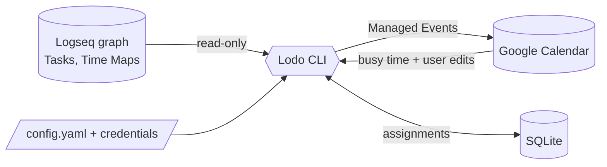

# Lodo

A personal, local-first scheduler for a Logseq TODO list. Lodo reads Tasks from a Logseq
graph, decides *when* to work on them, and projects the resulting schedule onto Google
Calendar.

> Status: **early implementation.** The Go binary is under construction from the
> specification in [`docs/`](docs/).

## How it fits together

Logseq is where intent lives (Tasks, Time Maps) and is the only interface. Lodo is a CLI
that computes a schedule and writes it to one Google Calendar. Local SQLite state is the
source of truth for the schedule; the calendar is a projection of it.



## Development

All tooling runs in containers via podman, so there is nothing to install locally beyond
podman itself — no Go, no Hugo, no `make`. [`scripts/dev.sh`](scripts/dev.sh) is the
entry point:

```sh
./scripts/dev.sh build   # build the CLI to ./dist/lodo
./scripts/dev.sh test    # go test ./...
./scripts/dev.sh vet     # go vet ./...
./scripts/dev.sh fmt     # gofmt ./cmd ./internal
./scripts/dev.sh lint    # golangci-lint
./scripts/dev.sh tidy    # go mod tidy
```

The containers run as your own user (rootless podman remaps the UID with
`--userns=keep-id`, and `--user` overrides whatever `USER` the image declares), so files
written by the tools — build output, module caches under `/tmp`, the fetched docs theme —
are owned by you, not root.

## Documentation

The documentation is a self-contained Hugo site under [`docs/`](docs/): content in
`docs/content/`, config in `docs/hugo.toml`. The geekdoc theme is pinned in
[`scripts/dev.sh`](scripts/dev.sh) and fetched into the gitignored `docs/themes/` on
demand. The pages:

- [`docs/content/specs/glossary.md`](docs/content/specs/glossary.md) — the language. Start here.
- [`docs/content/specs/overview.md`](docs/content/specs/overview.md) — concept map and pipeline.
- [`docs/content/specs/scope.md`](docs/content/specs/scope.md) — what's in v0.1 and what's deferred.
- [`docs/content/specs/tasks.md`](docs/content/specs/tasks.md) — what a Task is and how it's written in Logseq.
- [`docs/content/specs/time-maps.md`](docs/content/specs/time-maps.md) — preferred hours, in the graph.
- [`docs/content/specs/scheduling.md`](docs/content/specs/scheduling.md) — ordering, objective, infeasibility.
- [`docs/content/specs/calendar.md`](docs/content/specs/calendar.md) — Google Calendar integration.
- [`docs/content/specs/logseq-integration.md`](docs/content/specs/logseq-integration.md) — reading the graph.
- [`docs/content/specs/configuration.md`](docs/content/specs/configuration.md) — config and secrets.
- [`docs/content/specs/cli.md`](docs/content/specs/cli.md) — commands and flags.
- [`docs/content/ADRs/`](docs/content/ADRs/) — the decisions worth remembering, with reasons.

## Previewing the documentation site

```sh
./scripts/dev.sh docs        # live server on http://localhost:1313/lodo/
./scripts/dev.sh docs-build  # one-off minified build into docs/public/
./scripts/dev.sh docs-theme  # only (re)fetch the pinned theme
```

The first two use the same `ghcr.io/gohugoio/hugo` image as CI — see
[`.github/workflows/hugo.yml`](.github/workflows/hugo.yml) for the current tag (currently
`v0.168.0`). `docs-theme` downloads the pinned geekdoc release tarball, verifies its
checksum, and extracts it into `docs/themes/hugo-geekdoc/`; the directory is gitignored.
The `--bind 0.0.0.0` needed to make the published port reachable is wired into the script.

Then open <http://localhost:1313/lodo/> — note the `/lodo/` subpath, which comes from
`baseURL` in `hugo.toml`.
