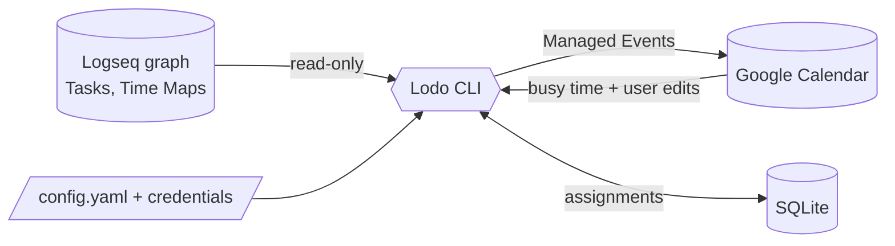

# Lodo

A personal, local-first scheduler for a Logseq TODO list. Lodo reads Tasks from a Logseq
graph, decides *when* to work on them, and projects the resulting schedule onto Google
Calendar.

> Status: **early implementation.** The Go binary is under construction from the
> specification in [`docs/`](docs/).

## How it fits together

Logseq is where intent lives (Tasks, Time Maps) and is the only interface. Lodo is a CLI
that computes a schedule and writes it to one Google Calendar. Local SQLite state is the
source of truth for the schedule; the calendar is a projection of it.



## Documentation

The documentation is a self-contained Hugo site under [`docs/`](docs/): content in
`docs/content/`, no build tooling at the repository root. The pages:

- [`docs/content/specs/glossary.md`](docs/content/specs/glossary.md) — the language. Start here.
- [`docs/content/specs/overview.md`](docs/content/specs/overview.md) — concept map and pipeline.
- [`docs/content/specs/scope.md`](docs/content/specs/scope.md) — what's in v0.1 and what's deferred.
- [`docs/content/specs/tasks.md`](docs/content/specs/tasks.md) — what a Task is and how it's written in Logseq.
- [`docs/content/specs/time-maps.md`](docs/content/specs/time-maps.md) — preferred hours, in the graph.
- [`docs/content/specs/scheduling.md`](docs/content/specs/scheduling.md) — ordering, objective, infeasibility.
- [`docs/content/specs/calendar.md`](docs/content/specs/calendar.md) — Google Calendar integration.
- [`docs/content/specs/logseq-integration.md`](docs/content/specs/logseq-integration.md) — reading the graph.
- [`docs/content/specs/configuration.md`](docs/content/specs/configuration.md) — config and secrets.
- [`docs/content/specs/cli.md`](docs/content/specs/cli.md) — commands and flags.
- [`docs/content/ADRs/`](docs/content/ADRs/) — the decisions worth remembering, with reasons.

## Previewing the documentation site

The site root is [`docs/`](docs/): content in `docs/content/`, config in `docs/hugo.toml`,
theme vendored in `docs/themes/`. Preview it with the same container image CI uses — see
`.github/workflows/hugo.yml` for the current tag (currently `v0.168.0`):

```sh
podman run --rm -it \
  -v "$PWD/docs:/project:Z" \
  -p 1313:1313 \
  ghcr.io/gohugoio/hugo:v0.168.0 \
  server --bind 0.0.0.0
```

Then open <http://localhost:1313/lodo/> — note the `/lodo/` subpath, which comes from
`baseURL` in `hugo.toml`.

Notes:

- `--bind 0.0.0.0` is required; without it the server only listens on the container's
  loopback interface and the published port stays unreachable.
- `:Z` relabels the mount for SELinux (Fedora/RHEL); it is a no-op elsewhere.
- The image runs as the `hugo` user (uid 1000). If you hit permission errors on
  `resources/` or `public/`, re-run with `--user root` (as CI does); files it creates
  will then be root-owned.
- For a one-off production-parity build instead of a live server:

```sh
podman run --rm -v "$PWD/docs:/project:Z" ghcr.io/gohugoio/hugo:v0.168.0 --minify
```
