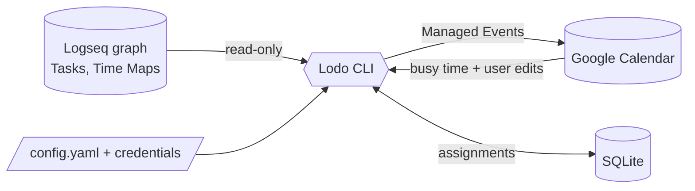

# Lodo

A personal, local-first scheduler for a Logseq TODO list. Lodo reads Tasks from a Logseq
graph, decides *when* to work on them, and projects the resulting schedule onto Google
Calendar.

> Status: **specification stage.** There is no code yet. This repository holds the
> specification and the decisions behind it.

## How it fits together

Logseq is where intent lives (Tasks, Time Maps) and is the only interface. Lodo is a CLI
that computes a schedule and writes it to one Google Calendar. Local SQLite state is the
source of truth for the schedule; the calendar is a projection of it.

## Documentation

- [`docs/specs/glossary.md`](docs/specs/glossary.md) — the language. Start here.
- [`docs/specs/overview.md`](docs/specs/overview.md) — concept map and pipeline.
- [`docs/specs/scope.md`](docs/specs/scope.md) — what's in v0.1 and what's deferred.
- [`docs/specs/tasks.md`](docs/specs/tasks.md) — what a Task is and how it's written in Logseq.
- [`docs/specs/time-maps.md`](docs/specs/time-maps.md) — preferred hours, in the graph.
- [`docs/specs/scheduling.md`](docs/specs/scheduling.md) — ordering, objective, infeasibility.
- [`docs/specs/calendar.md`](docs/specs/calendar.md) — Google Calendar integration.
- [`docs/specs/logseq-integration.md`](docs/specs/logseq-integration.md) — reading the graph.
- [`docs/specs/configuration.md`](docs/specs/configuration.md) — config and secrets.
- [`docs/specs/cli.md`](docs/specs/cli.md) — commands and flags.
- [`docs/ADRs/`](docs/ADRs/) — the decisions worth remembering, with reasons.
