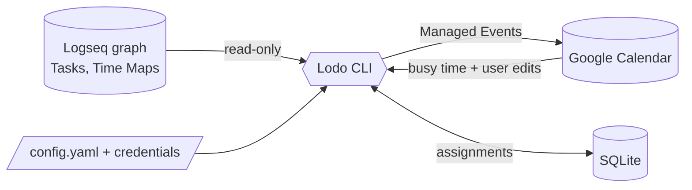

Lodo is a personal, local-first scheduler. Logseq holds intent, Lodo decides *when*,
Google Calendar shows the result.

## How it fits together



* **Logseq is the interface.** Tasks and Time Maps live in the graph. Lodo never
  writes Tasks back (except one prompted bootstrap, see below).
* **The Schedule lives in SQLite.** The calendar is a projection of it.
* **A CLI you invoke.** `check`, `forecast`, `schedule`, `refresh`, `auth google`.
  Cron calling `lodo schedule` is the intended deployment.

See [Specifications](specs/) for the full language — start with the
[Glossary](specs/glossary.md) — and [Guides](../guides/) for task entry.

## Tasks, Plans, Pins

* A **Task** is a `TODO` / `DOING` block with an explicit `duration::`
  (`90m`, `2h`, `1h30m`). No duration = note, never scheduled.
* **Plan** (`plan-start::` / `plan-end::`, day-granular) says *when by*:
  flexible, complete-by, no-earlier-than, or a window.
* **Pin** (`scheduled::`, exact date-time) says *exactly when* and never moves.
* **Deadline** (`deadline::`) is reference only — it never places a Task.
* **Priority** (`priority::` A/B/C) orders Tasks competing for the same hours.

Spec: [Tasks](specs/tasks.md), [Scheduling](specs/scheduling.md).

## Time Maps — which hours of the week

Named weekly patterns (`Deep Work`, `Errands`, `Weekends`), authored on the
`Time Maps` page in the graph:

```markdown
- Deep Work
  - Mon-Fri 09:00-11:00
  - Sat 10:00-12:00 yellow
- Errands
  - Sat 10:00-13:00
```

Each window carries a tier: green first, then yellow, then red.
A Task names its maps with `time-map:: deep-work` (or inherits from parent
blocks / page / default map) and spills into the default map when full.

Spec: [Time Maps](specs/time-maps.md).

## Dependencies and nesting

* `depends:: ((uuid)), ((uuid))` — strict finish-to-start, AND across refs.
* `order:: sequential | parallel` on a parent chains leaf Tasks in outline order.
* Parents with Task children are **containers** — never scheduled themselves.
* `DONE` / `CANCELLED` satisfies dependents; a `DONE` parent suppresses its subtree.

Spec: [Tasks — Dependencies & Nesting](specs/tasks.md#dependencies--what-waits-for-what).

## Scheduling — front-load, never guess

* Order: Pins first, then topological (deps before dependents), then time-bound
  by `plan-end::`, then flexible by priority and outline order.
* Front-loaded inside one tier: earliest fitting hours win.
* A no-change run is a strict **no-op**. Same inputs = identical Schedule.
* Infeasibility is **reported, never silently resolved**: shortfall with
  hours needed vs available, `blocked by …`, pin violations, cycles.

Spec: [Scheduling](specs/scheduling.md).

## Calendar — one write, many read

* Exactly one **write calendar** (`calendar.id`). Every Managed Event carries
  `lodo=true` and a deterministic id — re-inserts are idempotent.
* Any number of **read calendars** (`calendar.read_calendars`) contribute busy
  time only, never written to.
* Moves become **Pinned Blocks**, deletes **stand down** that Block until the
  Task's inputs change. `refresh` folds edits without recomputing.

Spec: [Calendar Integration](specs/calendar.md).

## Multiple graphs

Work, family, personal graphs merge into one Schedule:

```yaml
logseq:
  graphs:
    - name: work
      api_url: http://127.0.0.1:12315/api
      default_time_map: deep-work
    - name: family
      api_url: http://127.0.0.1:12316/api
      default_time_map: weekends
```

Each graph needs its own Logseq window on its own HTTP port (one endpoint =
current graph only). The canonical `Time Maps` page is read from the first
graph; each graph names a `default_time_map`, and any explicit `time-map::`
on a Task, parent block, or page overrides it. `depends::` and `order::`
chains stay graph-local. See [Configuration](specs/configuration.md) and
[Logseq Integration](specs/logseq-integration.md).

## What Lodo is not (v0.1)

Bundling, buffers, auto-defer, zones/budgets, recurring habits, Outlook/iCloud,
write-back into the graph, NLP, any UI. Full list in
[Scope](specs/scope.md).
