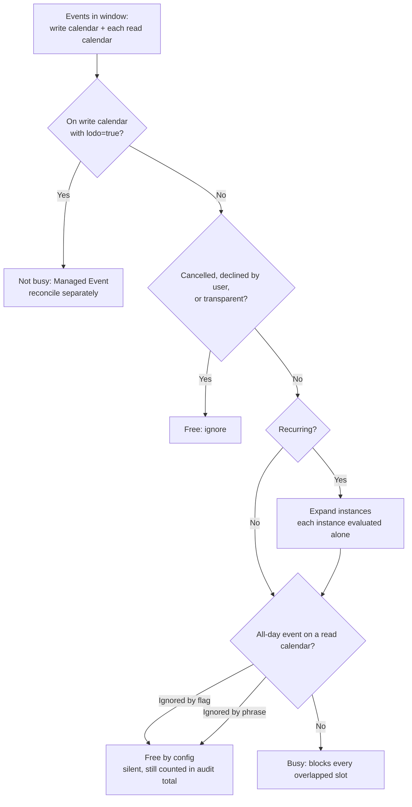
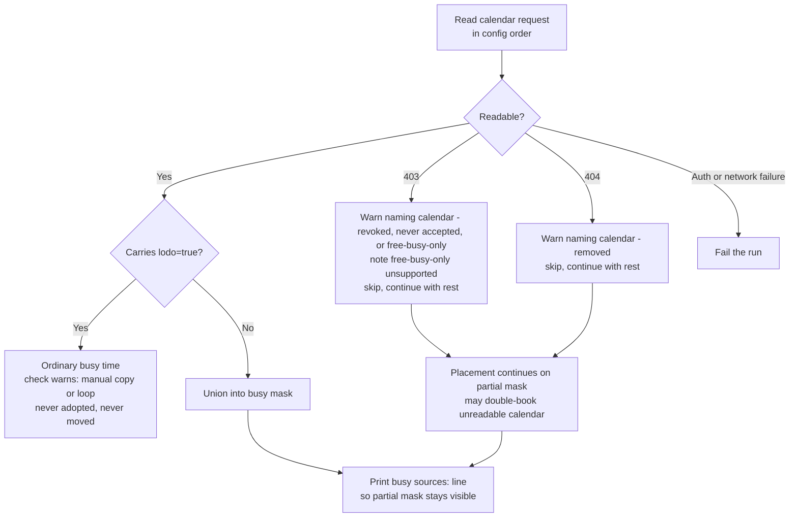
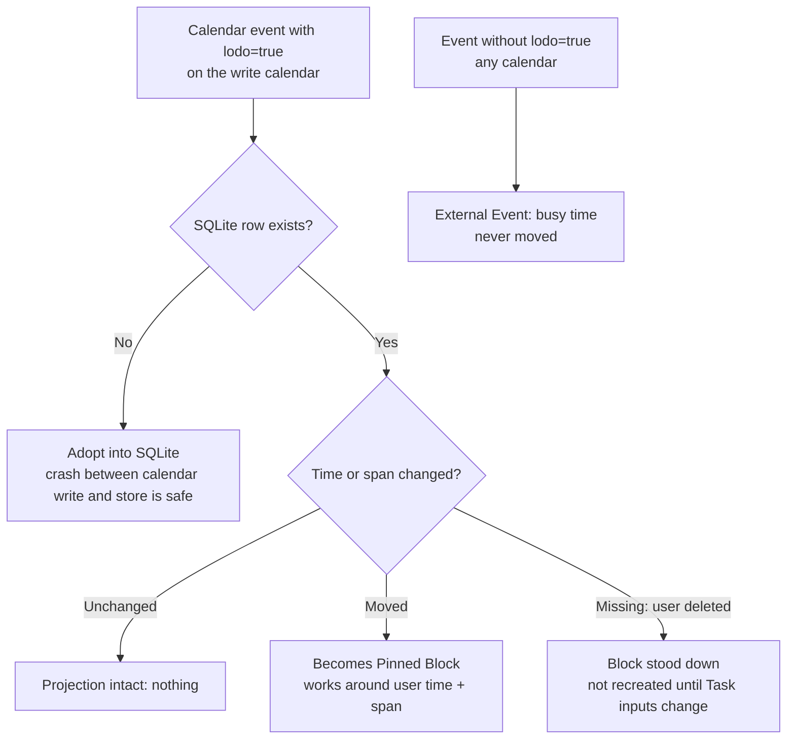
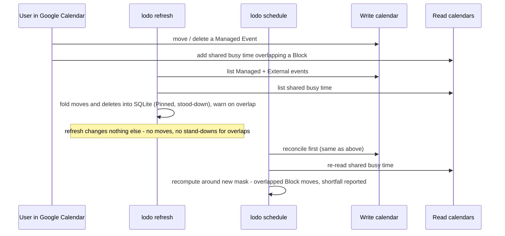

> Status: **draft (v0.1).**

Google Workspace Calendar only in v0.1. Outlook and iCloud are out of scope. There is
exactly **one** write Calendar (the one named by `calendar.id`), plus any number of
read-only shared calendars (named by `calendar.read_calendars`) that contribute busy
time; Time Maps are not calendars.

## Auth

- **Loopback OAuth** as the user, one-time, via `lodo auth google`. The refresh token is
  written to `credentials.json` (`0600`), never into the graph.
- Scope: `https://www.googleapis.com/auth/calendar.events` (read and write events).
- The write calendar is `calendar.id` from `config.yaml` (default `primary`).
- Shared calendars listed in `calendar.read_calendars` are busy-time input only.
  Lodo never writes to them, even if the Google share grants write access. Each
  share must be accepted and grant at least reader access; free/busy-only shares
  are not yet supported.
- A machine with no browser finishes the same grant elsewhere:
  `lodo auth google --no-launch-browser` prints the authorization URL to complete on any
  device, and the redirect address Google then shows — or the code inside it — is pasted
  back on one line to exchange. The loopback `redirect_uri`, PKCE verifier and exchange
  are the same, so a tunnelled redirect completes the flow unchanged. Google's login is
  one system for personal and Workspace accounts; the account approved with is the one
  Lodo reads.

### Creating the OAuth client (one-time setup)

`lodo auth google` needs an OAuth client you own — Google has no shared Lodo
client. Create a **Desktop app** client in your own Cloud project:

1. Create a project — [Create a Google Cloud project](https://developers.google.com/workspace/guides/create-project).
2. Enable the Calendar API in it — [Enable Google Workspace APIs](https://developers.google.com/workspace/guides/enable-apis).
3. Configure the consent screen — [Configure the OAuth consent screen](https://developers.google.com/workspace/guides/configure-oauth-consent):
   user type **External**, add your personal Gmail as a test user, and add the
   `calendar.events` scope. The unverified-app warning at grant time is normal
   for a personal client.
4. Create the client — [Create access credentials](https://developers.google.com/workspace/guides/create-credentials)
   (section *Desktop app*). Its redirect URI is `http://127.0.0.1/`.
5. Paste the pair into the credentials file beside the Logseq token if present:

   ```json
   {"google": {"client_id": "…", "client_secret": "…"}}
   ```

6. Run `lodo auth google` and approve with the account whose calendar Lodo
   should use; `calendar.id` then names the one calendar inside it.

## Identifying a Managed Event

Ownership is recorded on the event itself, so it survives Lodo losing its local state:

- Every Managed Event carries **`extendedProperties.private`**:
  `lodo=true`, `task=<Logseq block UUID>`, `block=<index>`.
- Every Managed Event is inserted with a **client-supplied deterministic `id`**
  (base32hex, derived from the Task's block UUID and block index), so re-inserting is
  idempotent and cannot duplicate.
- The **title is the Task's own text**, unmarked — the block looks natural in Google.
- **No title markers, no separate calendar.**

The ownership test is therefore: *an event is Managed iff it carries `lodo=true`.*
Everything else on the write calendar, and everything on a read calendar, is an
**External Event**: busy time, never moved.

### Task identity

A Task is identified across runs by its **Logseq block UUID**, not its title. Renaming a
Task does not orphan its Blocks or its calendar events.

## Event shape

```json
{
  "id": "lodo<base32hex>",
  "summary": "Write deep report",
  "start": { "dateTime": "2026-10-20T09:00:00+01:00", "timeZone": "Europe/London" },
  "end":   { "dateTime": "2026-10-20T11:00:00+01:00", "timeZone": "Europe/London" },
  "extendedProperties": {
    "private": { "lodo": "true", "task": "<logseq-block-uuid>", "block": "0" }
  },
  "reminders": { "useDefault": true }
}
```

Times use `scheduling.timezone`. Reminders use the calendar's defaults.

## Busy time

Lodo reads the write calendar and every read calendar within the Scheduling window
and unions their busy time to compute availability. The same rules apply on every
calendar; only Managed-event detection is write-calendar-only:



How shared calendars affect the Schedule: they only ever *remove* hours at the
`Subtract busy time` step in [`scheduling.md`](./scheduling.md). A shared event can
force fragmentation, push a Task into a later tier (yellow/red), or turn a fit into a
shortfall — it can never create hours, move a Pin, or reorder Tasks.

- **Busy** = any event that is not Managed (write calendar only), not `cancelled`,
  not declined by the user, and whose `transparency` is not `transparent`.
- **All-day** events count as busy on every calendar, unless read-calendar config
  says otherwise. `calendar.ignore_read_all_day: true` drops every all-day event on
  a read calendar. `calendar.ignore_read_all_day_matching` drops only all-day
  read-calendar events whose summary contains one of the phrases
  (case-insensitive); timed events are never matched, and the list is unused when
  the flag is true. The write calendar is unchanged: mark a birthday free there, or
  leave it busy. A configured skip is silent and the event still counts in the
  audit total.
- Recurring events contribute their expanded instances.
- A `lodo=true` event found on a read calendar is ordinary busy time: never adopted
  into SQLite, never moved. `lodo check` warns about it, since it signals a manual
  copy or a calendar loop.

### Unreadable shares



A read calendar that answers 403 (revoked, never accepted, or free/busy-only share)
or 404 (removed calendar) is skipped with a warning, and the run continues with the
calendars that did read. The warning names the calendar; for 403 it also notes that
free/busy-only shares are not yet supported. Auth and network failures still fail the
run. Every `forecast`, `schedule`, and `refresh` prints which calendars were read
(`busy sources:`) so a placement made with a partial mask stays visible.

## Reconciliation on `refresh`



Every `schedule` reconciles first. The rules:

| Observed | Meaning | Lodo's response |
| --- | --- | --- |
| Managed event, time unchanged | projection intact | nothing |
| Managed event, time changed | user moved it | becomes a **Pinned Block**; Lodo works around it |
| Managed event missing | user deleted it | that **Block** becomes **stood down**; not recreated until its Task's inputs change. Surviving Blocks stay projected |
| `lodo=true` event with no SQLite row | Lodo's state was lost | adopted into SQLite |
| Event without `lodo=true` | an External Event | busy time; never moved |

Stood-down is **per-Block**: deleting a Managed Event stands down only that Block,
not the whole Task. The Task's remaining Blocks stay projected and future runs may place
the missing hours elsewhere once the Task's inputs change. A moved
event becomes a Pinned Block and stays pinned at the user-chosen time and span — through unrelated changes to the Task's
own inputs, adopting the Task's current title — until its event is deleted. Both are treated as intent: Lodo does not
silently recreate work the user removed. `lodo check` lists stood-down Blocks so they stay
visible. Whether a Task's inputs have changed is judged against Lodo's snapshot of its
resolved inputs — direct and inherited properties, plus its text — taken on the run that
recorded the disposition.

### Shared-calendar conflicts on `refresh`



`refresh` reads the write calendar and all read calendars. A Managed Block that now
overlaps shared busy time is reported as a warning naming the Block. `refresh`
changes nothing in response: no moves, no stand-downs. Re-placement happens only in
`schedule`.

Adoption is also what makes `schedule` writing the calendar **before** the store safe: a
crash between the two leaves `lodo=true` events with no local row, which the next run
adopts. See [ADR 0007](../ADRs/0007-write-the-calendar-before-the-store.md).

## Deferred

Auto-Defer; suggestions; writing completion back; free/busy-only calendar shares;
per-event reminders; Outlook and iCloud.
