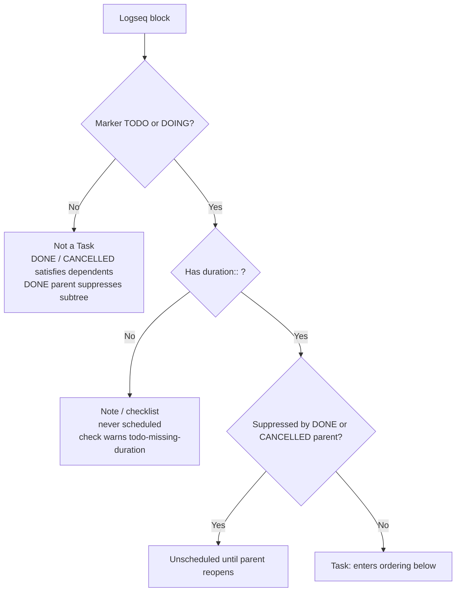
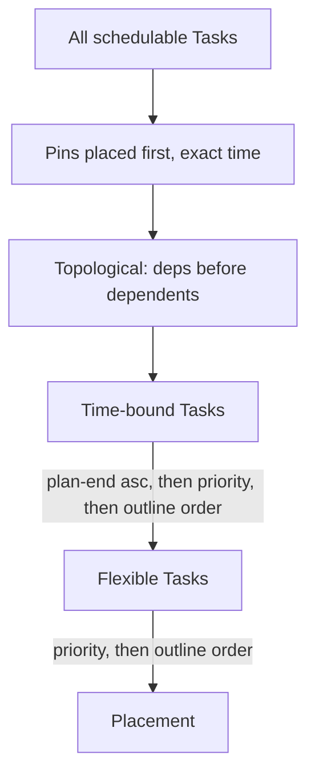
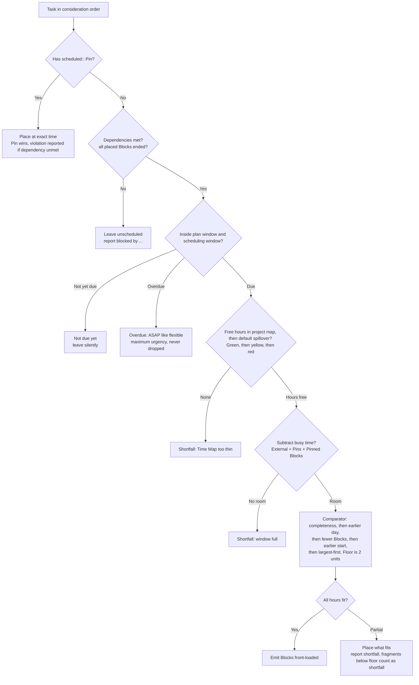
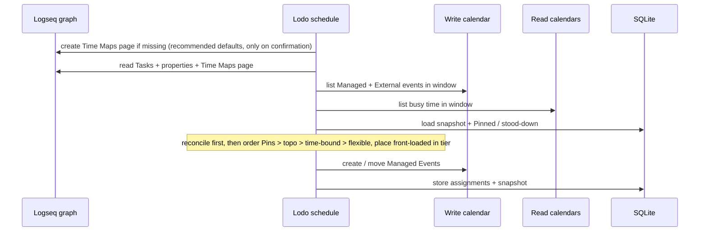
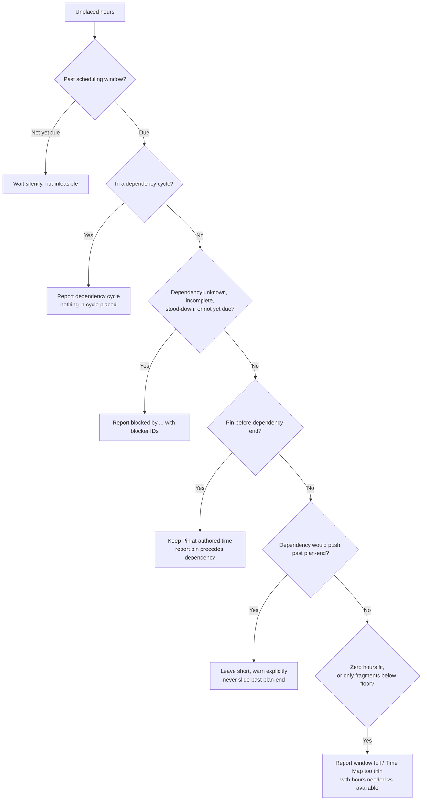

> Status: **draft (v0.1).** Ordering and the placement objective are settled. The
> comparator's key order is [ADR 0010](../ADRs/0010-placement-comparator.md); the
> candidate rules and examples are [below](#placement-comparator).

How Lodo turns Tasks into Blocks. Inputs are Tasks ([`tasks.md`](./tasks.md)), their
Time Maps ([`time-maps.md`](./time-maps.md)), the Calendar's busy time, and the
Scheduling granularity and window ([`configuration.md`](./configuration.md)).

## Eligibility

Not every `TODO` is scheduled. This decision runs before ordering:

The gate is `TODO`/`DOING` **and** `duration::` ([`tasks.md`](./tasks.md)). Everything
below assumes the block passed it.

## Ordering

Only the *order in which Tasks are considered* is settled here; how a Task is placed is
covered by the objective below, whose comparator is settled in
[ADR 0010](../ADRs/0010-placement-comparator.md).

1. **Pins are placed first**, at their exact time. They are immovable, so everything else
   schedules around them — as does the busy time from External Events. A Pin with
   dependencies stays (Pin wins); the violation is reported.
2. **Dependencies topologically override buckets**: a dependency is always placed
   before its dependents, even when that promotes a flexible Task ahead of a
   time-bound one. Among unrelated Tasks the rule below is the tie-break.
3. **Time-bound Tasks next** (those with `plan-start::` and/or `plan-end::`), ordered by
   `plan-end::` ascending, then `priority::`, then outline order.
4. **Flexible Tasks last**, ordered by `priority::`, then outline order. Containers
   never enter the order (unscheduled by definition).

### Consequences of this rule

- **A Task due today always beats a Flexible Task**, even a higher-priority one: every
  time-bound Task is considered before any flexible Task. This matches SkedPal's
  "Scenario II" (a task that must be done today takes the last free hour).
- **`priority::` is only three levels** (A/B/C, Logseq's native values). Urgency
  supplies the missing granularity: `plan-end::` is the second sort axis. A separate
  numeric rank is the escape hatch if A/B/C proves too coarse, and is deferred.
- **Outline order is the final tie-break.** Outline order is the depth-first,
  top-to-bottom order of blocks as displayed in Logseq and returned by the HTTP API
  (page order, then tree order). It is free and deterministic, but it means
  *moving a block in your notes silently re-prioritises it*. This is accepted for v0.1;
  `forecast` / `schedule --verbose` states when the tie-break decided placement so the
  re-prioritisation is visible rather than silent
  ([ADR 0022](../ADRs/0022-outline-order-is-a-priority.md)).

## Objective

**Front-load, inside a preference tier.** Place each Task as early as its constraints
(Plan window, Time Maps, busy time) allow — SkedPal's "as early as possible" / fuzzy
planning, not just-in-time. Time Map windows carry a tier. Hours still required are
placed in green first, then yellow, then red, so a later green window beats an earlier
yellow one ([ADR 0014](../ADRs/0014-preference-tiers-before-the-comparator.md)).
A Task naming its own map prefers that map, then spills into the default map
at the same tier or worse — never into a better tier than its own best.

Inside one tier the [placement comparator](#placement-comparator) chooses the
arrangement. The order of its keys is
[ADR 0010](../ADRs/0010-placement-comparator.md).

### Placement comparator

A Task needs `n = ceil(duration / granularity)` slots. A candidate placement is an
arrangement of at most `n` slots into Blocks, drawn from the Task's free slots:

- each Block is a run of consecutive free slots — free meaning inside the Task's Time
  Maps and Plan window, not in the past, and not occupied by busy time, Pins, or Pinned
  Blocks;
- at most one Block per free run, starting at the run's first slot;
- each Block is at least two granularity units (the Minimum Block floor), except a Task
  whose whole duration rounds up to a single unit (`n = 1`), which is emitted as one
  unit;
- the Blocks' sizes sum to at most `n`.

Candidates are compared lexicographically, best first:

1. **Placed slots, descending.** Completeness comes first.
2. **Start day, ascending.** An earlier day beats a tidier later day.
3. **Block count, ascending.** Within a day, fewer Blocks beat earlier fragments.
4. **Block start slots, ascending.** The earlier first Block wins.
5. **Block sizes, descending.** The earliest free run is filled as far as it can be.

The keys are total, so the planner needs no further tie-break. Completeness outranks
contiguity. Contiguity is the rule among placements that place the same hours. Pins,
Pinned Blocks, and stood-down Blocks shape the free slots before candidates exist.

At 15m granularity, one day unless stated; runs written as `time@length`.

| n | Free runs | Winner | Because |
| --- | --- | --- | --- |
| 2 | 09:00@15m, 13:00@15m | nothing placed | Fragments below the floor are never emitted; 30m of shortfall is reported. |
| 4 | 09:00@30m, 13:00@45m | 09:00@30m + 13:00@30m | Completeness: 60m placed beats one 45m Block, because the extra 30m is a legal Block, not confetti. |
| 5 | 09:00@30m, 13:00@45m | 09:00@30m + 13:00@45m | The only placement that places all 75m. |
| 5 | 09:00@30m, 13:00@45m, 17:00@75m | 17:00@75m | Same-day contiguity: equal completeness, so one Block beats two that start earlier. |
| 6 | 09:00@60m, 13:00@60m | 09:00@60m + 13:00@30m | Largest-first: equal placement, so the earliest run is filled as far as possible. |

Across days, a 75m Task with only 30m available on day one and 75m available on day two
is placed as 30m on day one plus 45m on day two. Contiguity wins only within the same
day, so front-loading takes the earlier fragment.

### Placement decision for one Task

Shared and read-only calendars only ever narrow the `Subtract busy time` step —
see [`calendar.md`](./calendar.md). Time Maps pick *which* hours, the Plan picks
*which days*, busy time removes what is already taken.

## Run sequence

`schedule` always reconciles before computing, so a calendar move made between runs
is never clobbered. `refresh` stops after reconciliation (SQLite only).

## Stability

- **Deterministic.** The same inputs produce an identical Schedule. A run with no changed
  inputs is a strict **no-op**: nothing moves.
- **Minimal-churn displacement (emergent).** A newly added higher-priority *flexible*
  Task may displace lower-priority flexible Blocks — that is the point of Priority. The
  Schedule is computed from scratch each run, so unrelated Blocks staying put is a
  *consequence* of the ordering above and front-loading, not something Lodo remembers; a
  change to busy time can still shift a flexible tail. See
  [ADR 0006](../ADRs/0006-schedule-is-a-pure-function-of-intent.md).
- **Immovable things never move.** Pins, Pinned Blocks, External Events, and time-bound
  Tasks whose `plan-*` window is still satisfiable are never disturbed by other work.

## Infeasibility

Lodo **never silently violates a constraint.** When a Task cannot be placed within its
Plan window and the Scheduling window, it is left unscheduled (wholly or partly) and
reported, with the reason.

- **Window full / Time Map too thin** — reported: "needs 4h of Deep Work before
  2026-10-24; 1h available".
- **Beyond the horizon** — not infeasible: the Task is simply not due yet. It is left
  unplaced *silently* until it enters the Scheduling window.
- **Partial fit** — Lodo schedules the hours that do fit and reports the shortfall
  prominently. Fragments below the minimum Block floor are never emitted; they count
  toward the reported shortfall.
- **Blocked by dependencies** — a dependent whose dependency is incomplete,
  stood-down, unknown, in a cycle, or not yet due is left unscheduled and reported
  as `blocked by …` with the blocker IDs. A time-bound Task whose dependency pushes
  it past its `plan-end::` warns explicitly rather than silently sliding.
- **Dependency cycle** — Tasks in the cycle are left unscheduled and reported;
  the cycle is never broken silently.
- **Pin precedes dependency** — the Pin stays at its authored time and the order
  violation is reported.

No Auto-Defer, no Time-Map-violation escape hatch. Suggestions are advisory-only:
for each reported shortfall Lodo proposes the minimal relief (move `plan-end::`
by N days when `plan-end` bounds placement inside the current window — suppressed
when the window itself is the limit — with impact as an estimate like
`adds ~N days of eligible <tier> capacity`, spill to an allowed default tier
`if free` without verifying calendar occupancy, add Time Map hours on the
thinnest eligible days, reduce duration, or fix blockers/maps) in human output
and `--json` with stable `reason`/`change`/`impact`/`tier`.
Blocked tasks get blocker fixes only (no `restore-stood-down` noise).
Time Map hour advice is currently add-only; shifting hours stays future work.
Lodo never applies them automatically
([report, do not repair](../ADRs/#report-do-not-repair)).
