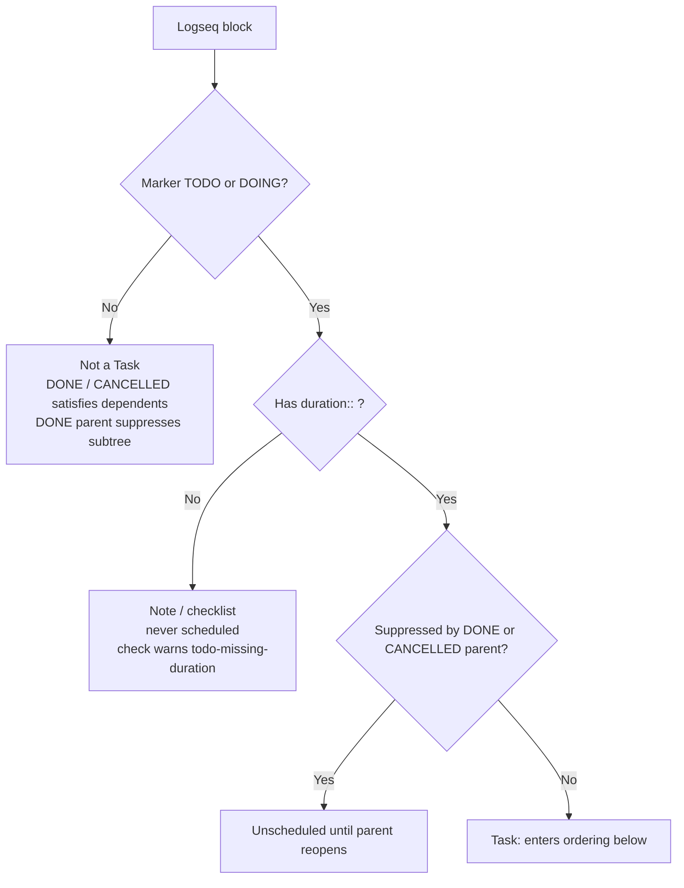
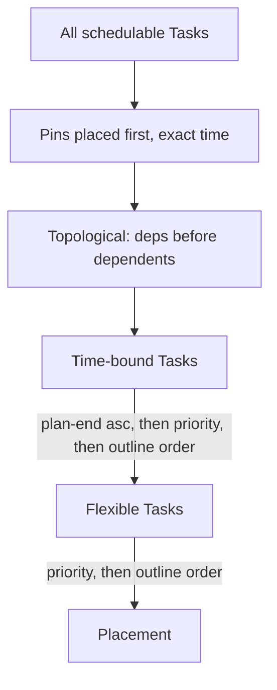
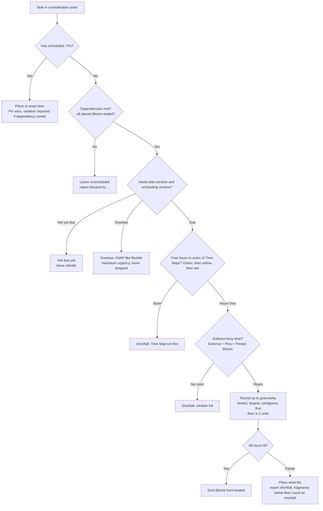
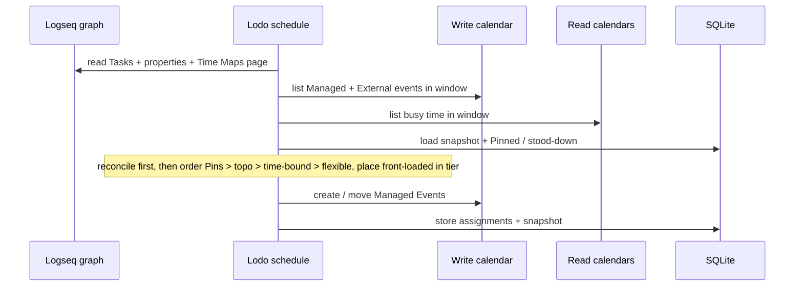
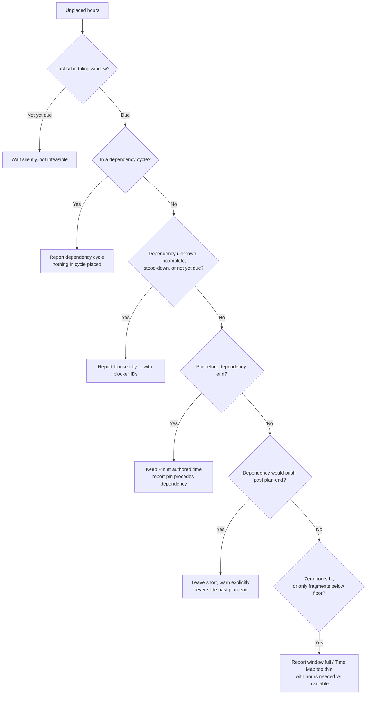

> Status: **draft (v0.1).** Ordering and the placement objective are settled — the
> comparator is in [ADR 0010](../ADRs/0010-placement-comparator.md).

How Lodo turns Tasks into Blocks. Inputs are Tasks ([`tasks.md`](./tasks.md)), their
Time Maps ([`time-maps.md`](./time-maps.md)), the Calendar's busy time, and the
Scheduling granularity and window ([`configuration.md`](./configuration.md)).

## Eligibility

Not every `TODO` is scheduled. This decision runs before ordering:

The gate is `TODO`/`DOING` **and** `duration::` ([`tasks.md`](./tasks.md)). Everything
below assumes the block passed it.

## Ordering

Only the *order in which Tasks are considered* is settled here; how a Task is placed is
covered by the objective below, whose comparator is settled in
[ADR 0010](../ADRs/0010-placement-comparator.md).

1. **Pins are placed first**, at their exact time. They are immovable, so everything else
   schedules around them — as does the busy time from External Events. A Pin with
   dependencies stays (Pin wins); the violation is reported.
2. **Dependencies topologically override buckets**: a dependency is always placed
   before its dependents, even when that promotes a flexible Task ahead of a
   time-bound one. Among unrelated Tasks the rule below is the tie-break.
3. **Time-bound Tasks next** (those with `plan-start::` and/or `plan-end::`), ordered by
   `plan-end::` ascending, then `priority::`, then outline order.
4. **Flexible Tasks last**, ordered by `priority::`, then outline order. Containers
   never enter the order (unscheduled by definition).

### Consequences of this rule

- **A Task due today always beats a Flexible Task**, even a higher-priority one: every
  time-bound Task is considered before any flexible Task. This matches SkedPal's
  "Scenario II" (a task that must be done today takes the last free hour).
- **`priority::` is only three levels** (A/B/C, Logseq's native values). Urgency
  supplies the missing granularity: `plan-end::` is the second sort axis. A separate
  numeric rank is the escape hatch if A/B/C proves too coarse, and is deferred.
- **Outline order is the final tie-break.** Outline order is the depth-first,
  top-to-bottom order of blocks as displayed in Logseq and returned by the HTTP API
  (page order, then tree order). It is free and deterministic, but it means
  *moving a block in your notes silently re-prioritises it*. This is accepted for v0.1;
  `forecast` / `schedule --verbose` states when the tie-break decided placement so the
  re-prioritisation is visible rather than silent.

## Objective

**Front-load, inside a preference tier.** Place each Task as early as its constraints
(Plan window, Time Maps, busy time) allow — SkedPal's "as early as possible" / fuzzy
planning, not just-in-time. Time Map windows carry a tier. Hours still required are
placed in green first, then yellow, then red, so a later green window beats an earlier
yellow one ([ADR 0014](../ADRs/0014-preference-tiers-before-the-comparator.md)).

Inside one tier, completeness comes first, then the comparator in
[ADR 0010](../ADRs/0010-placement-comparator.md): placed hours, start day, Block count,
earliest start, largest-first sizes.

### Placement decision for one Task

Shared and read-only calendars only ever narrow the `Subtract busy time` step —
see [`calendar.md`](./calendar.md). Time Maps pick *which* hours, the Plan picks
*which days*, busy time removes what is already taken.

## Run sequence

`schedule` always reconciles before computing, so a calendar move made between runs
is never clobbered. `refresh` stops after reconciliation (SQLite only).

## Stability

- **Deterministic.** The same inputs produce an identical Schedule. A run with no changed
  inputs is a strict **no-op**: nothing moves.
- **Minimal-churn displacement (emergent).** A newly added higher-priority *flexible*
  Task may displace lower-priority flexible Blocks — that is the point of Priority. The
  Schedule is computed from scratch each run, so unrelated Blocks staying put is a
  *consequence* of the ordering above and front-loading, not something Lodo remembers; a
  change to busy time can still shift a flexible tail. See
  [ADR 0006](../ADRs/0006-schedule-is-a-pure-function-of-intent.md).
- **Immovable things never move.** Pins, Pinned Blocks, External Events, and time-bound
  Tasks whose `plan-*` window is still satisfiable are never disturbed by other work.

## Infeasibility

Lodo **never silently violates a constraint.** When a Task cannot be placed within its
Plan window and the Scheduling window, it is left unscheduled (wholly or partly) and
reported, with the reason.

- **Window full / Time Map too thin** — reported: "needs 4h of Deep Work before
  2026-10-24; 1h available".
- **Beyond the horizon** — not infeasible: the Task is simply not due yet. It is left
  unplaced *silently* until it enters the Scheduling window.
- **Partial fit** — Lodo schedules the hours that do fit and reports the shortfall
  prominently. Fragments below the minimum Block floor are never emitted; they count
  toward the reported shortfall.
- **Blocked by dependencies** — a dependent whose dependency is incomplete,
  stood-down, unknown, in a cycle, or not yet due is left unscheduled and reported
  as `blocked by …` with the blocker IDs. A time-bound Task whose dependency pushes
  it past its `plan-end::` warns explicitly rather than silently sliding.
- **Dependency cycle** — Tasks in the cycle are left unscheduled and reported;
  the cycle is never broken silently.
- **Pin precedes dependency** — the Pin stays at its authored time and the order
  violation is reported.

No Auto-Defer, no Time-Map-violation escape hatch, and no Suggestions in v0.1. Each of
those is a policy for breaking a rule, and v0.1 has none.
