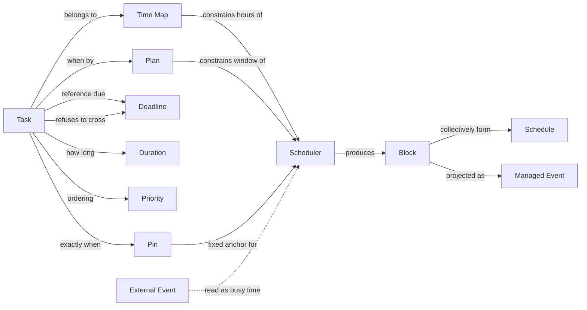
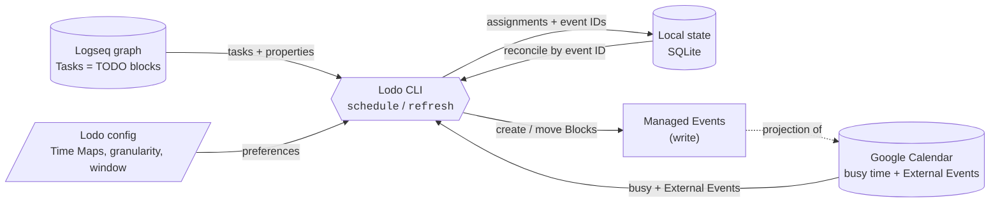

# Lodo — Concepts Overview

> Status: **draft, in progress.** This page is a visual companion to the glossary in
> [`glossary.md`](./glossary.md). Definitions live there; relationships live here.

## Concept map

How the core terms relate. A Task carries scheduling intent (Plan, Pin, Deadline,
Priority, Duration) and belongs to Time Maps that constrain *which hours of the week*
it may occupy. Lodo turns that into Blocks, which form the Schedule and are projected
onto one Calendar.

## Scheduling pipeline

## Status

All major v0.1 decisions are resolved. What is deferred, and the v0.2+ roadmap, is in
[`scope.md`](./scope.md).
