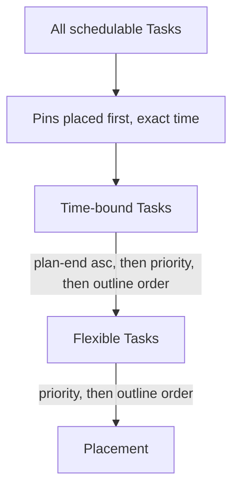

# Scheduling

> Status: **draft (v0.1).** Ordering is settled; objective and stability are still open.

How Lodo turns Tasks into Blocks. Inputs are Tasks ([`tasks.md`](./tasks.md)), their
Time Maps ([`time-maps.md`](./time-maps.md)), the Calendar's busy time, and the
Scheduling granularity and window ([`configuration.md`](./configuration.md)).

## Ordering

Only the *order in which Tasks are considered* is settled here; how a Task is placed is
covered by the objective (below, open).

1. **Pins are placed first**, at their exact time. They are immovable, so everything else
   schedules around them — as does the busy time from External Events.
2. **Time-bound Tasks next** (those with `plan-start::` and/or `plan-end::`), ordered by
   `plan-end::` ascending, then `priority::`, then outline order.
3. **Flexible Tasks last**, ordered by `priority::`, then outline order.

### Consequences of this rule

- **A Task due today always beats a Flexible Task**, even a higher-priority one: every
  time-bound Task is considered before any flexible Task. This matches SkedPal's
  "Scenario II" (a task that must be done today takes the last free hour).
- **`priority::` is only three levels** (A/B/C, Logseq's native values). Urgency
  supplies the missing granularity: `plan-end::` is the second sort axis. A separate
  numeric rank is the escape hatch if A/B/C proves too coarse, and is deferred.
- **Outline order is the final tie-break.** Outline order is the depth-first,
  top-to-bottom order of blocks as displayed in Logseq and returned by the HTTP API
  (page order, then tree order). It is free and deterministic, but it means
  *moving a block in your notes silently re-prioritises it*. This is accepted for v0.1;
  `forecast` / `schedule --verbose` states when the tie-break decided placement so the
  re-prioritisation is visible rather than silent.

## Objective

**Front-load.** Place each Task as early as its constraints (Plan window, Time Maps,
busy time) allow — SkedPal's "as early as possible" / fuzzy planning, not just-in-time.

## Stability

- **Deterministic.** The same inputs produce an identical Schedule. A run with no changed
  inputs is a strict **no-op**: nothing moves.
- **Minimal-churn displacement (emergent).** A newly added higher-priority *flexible*
  Task may displace lower-priority flexible Blocks — that is the point of Priority. The
  Schedule is computed from scratch each run, so unrelated Blocks staying put is a
  *consequence* of the ordering above and front-loading, not something Lodo remembers; a
  change to busy time can still shift a flexible tail. See
  [ADR 0006](../ADRs/0006-schedule-is-a-pure-function-of-intent.md).
- **Immovable things never move.** Pins, Pinned Blocks, External Events, and time-bound
  Tasks whose `plan-*` window is still satisfiable are never disturbed by other work.

## Infeasibility

Lodo **never silently violates a constraint.** When a Task cannot be placed within its
Plan window and the Scheduling window, it is left unscheduled (wholly or partly) and
reported, with the reason.

- **Window full / Time Map too thin** — reported: "needs 4h of Deep Work before
  2026-10-24; 1h available".
- **Beyond the horizon** — not infeasible: the Task is simply not due yet. It is left
  unplaced *silently* until it enters the Scheduling window.
- **Partial fit** — Lodo schedules the hours that do fit and reports the shortfall
  prominently. Fragments below the minimum Block floor are never emitted; they count
  toward the reported shortfall.

No Auto-Defer, no Time-Map-violation escape hatch, and no Suggestions in v0.1. Each of
those is a policy for breaking a rule, and v0.1 has none.
